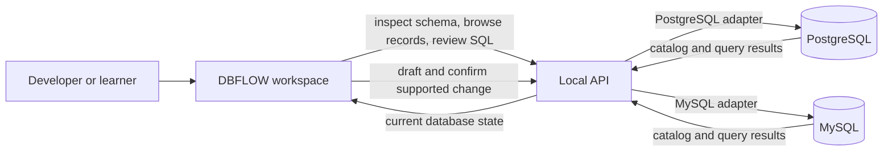

<div align="center">

# DBFLOW

### Understand your database at a glance.

**A visual workspace for exploring database structure, relationships, and records—then making carefully reviewed changes from one connected view.**

[Explore the project](https://github.com/mnm-0069/dbflow) · [Getting started](docs/GETTING_STARTED.md) · [Product and architecture](docs/PRODUCT_AND_ARCHITECTURE.md)


</div>

---

## The idea

Working with a database often means switching between a schema diagram, a query editor, and a separate table viewer. That makes it harder to see how a change relates to the data around it—and easier to lose track of what is live, what is only a draft, and what a command will do.

**DBFLOW brings those parts into one visual workspace.** The long-term idea is a clear, approachable place where developers and learners can understand a database, explore its data, and make intentional changes while staying grounded in the database's actual state.

The project is being built around a simple principle:

> **Make database work visible, connected, and reviewable.**

## What DBFLOW is working toward

- **See the structure.** Explore tables, columns, keys, and relationships on a schema canvas.
- **Follow the data.** Move from a table in the schema to its records and inspect results in the same workspace.
- **Understand a change before it happens.** Review supported schema changes and their generated SQL before confirming them.
- **Keep the view honest.** After a successful schema change, read the database again so the canvas reflects its current state.
- **Make it approachable.** Use a clearly labeled demo mode to explore the workspace without a database connection.

## What works in this version

| Area | Current capability |
| --- | --- |
| Database connections | Connect to PostgreSQL or MySQL through a local API session. |
| Schema canvas | Inspect visible tables, columns, primary keys, and foreign-key relationships. |
| Data explorer | Browse records in pages of up to 100 rows, sort across a table, search the loaded page, and edit eligible scalar values on tables with primary keys. |
| Reviewed schema changes | Draft a table or one supported `ADD COLUMN` change, inspect the generated SQL, then explicitly confirm execution. |
| SQL workspace | Run one read-only `SELECT` or read-only CTE, with bounded results. |
| Demo mode | Explore sample records and results without sending editor text to a database. |

**This is an early-stage project, and its current limits are part of the design story.** General-purpose SQL, arbitrary DDL, destructive data changes, row insertion and deletion, persistent connection profiles, and production accounts are not implemented. Search currently applies to the loaded page. See [Product and architecture](docs/PRODUCT_AND_ARCHITECTURE.md) for the full scope.

## How it works

The web app and local API are separate parts of the project. The web app presents the workspace; the API connects to a database, validates supported operations, and returns schema or record data.



For supported schema changes, DBFLOW follows a deliberate sequence: draft locally, validate on the API, show the normalized SQL, ask for confirmation, execute a short-lived one-use plan, and then inspect the database again.

## Try it locally

You can explore the demo without installing or configuring a database. Live features require a reachable PostgreSQL or MySQL instance.

### Requirements

- Node.js **20.19 or newer**
- npm **10 or newer**
- Docker Desktop or Docker Engine with Compose, if you want to run the included PostgreSQL walkthrough

### Start DBFLOW

```bash
git clone https://github.com/mnm-0069/dbflow.git
cd dbflow
npm install
npm run dev
```

Then open [http://localhost:5173](http://localhost:5173). The local API health endpoint is [http://localhost:4000/api/health](http://localhost:4000/api/health).

The default ports and settings work without an environment file. To adjust the API port or allowed web origin, copy `apps/api/.env.example` to `apps/api/.env` and edit the local values.

### Try the live PostgreSQL workflow

In another terminal, start the bundled local sample database:

```bash
npm run db:up
```

Connect in DBFLOW using host `127.0.0.1`, port `5433`, database `dbflow_demo`, username `dbflow`, password `dbflow_local_only`, and SSL off. Test the connection, inspect the schema, open a table, and try the read-only SQL workspace. The database contains linked customers, products, orders, and order items. Stop it with `npm run db:stop`.

This walkthrough needs Docker Desktop or Docker Engine with the Compose plugin. Its sample database is published only on loopback and uses a development-only password. The setup guide includes a sample query, port overrides, and instructions for removing the sample data.

For the complete connection walkthrough, see [Getting started](docs/GETTING_STARTED.md).

## Built with

- **Web:** React, TypeScript, Vite, React Flow, AG Grid Community, Monaco
- **API:** Node.js, Express, TypeScript, Zod
- **Database drivers:** PostgreSQL (`pg`) and MySQL (`mysql2`)
- **Shared contracts:** TypeScript package in `packages/shared`

## Safety and project scope

DBFLOW is a **local development project**, not a hosted database service. Connection credentials are held in expiring API memory sessions; the API binds to loopback; live SQL is read-only and bounded; and the supported schema operations require a reviewed, one-use plan and explicit confirmation.

These are useful guardrails for this prototype, not a claim of production security. The project does not yet provide production authentication, tenant isolation, audit controls, rate limiting, or complete hosted network egress protections. Use a least-privilege database account, and do not expose the local API as an unauthenticated network service.

## Product direction

The next stage is to make the core loop dependable before broadening the feature set:

1. Improve the live data workflow with stable server-side sorting and filtering.
2. Add focused interface coverage for connection errors, reviewed changes, schema refresh failures, and edit conflicts.
3. Verify real-engine behavior using an isolated test database.
4. Build learning and analytics experiences on top of the reliable schema-and-data foundation.

These are areas of exploration, not promises that every item is already implemented. The detailed decisions and boundaries are documented in [Product and architecture](docs/PRODUCT_AND_ARCHITECTURE.md).

## Project layout

```text
apps/web         Visual workspace
apps/api         Local API and database services
packages/shared  Shared TypeScript contracts
docs             Setup and product decisions
```

## Checks

```bash
npm run typecheck
npm run test --workspace @idp/api
npm run build
```

GitHub Actions runs these checks on pushes to `main` and on pull requests.

---

<div align="center">

**DBFLOW is an exploration of a more understandable way to work with databases:**
see the structure, follow the data, and review the change.

</div>
